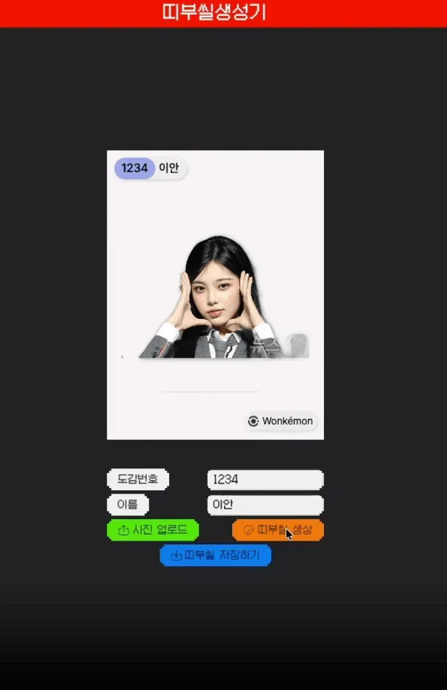
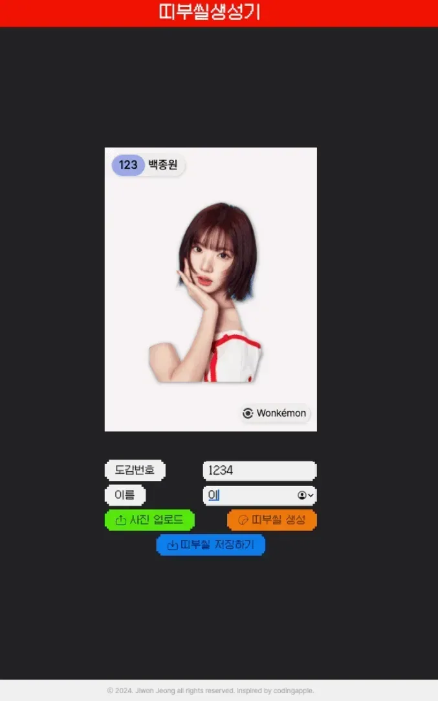
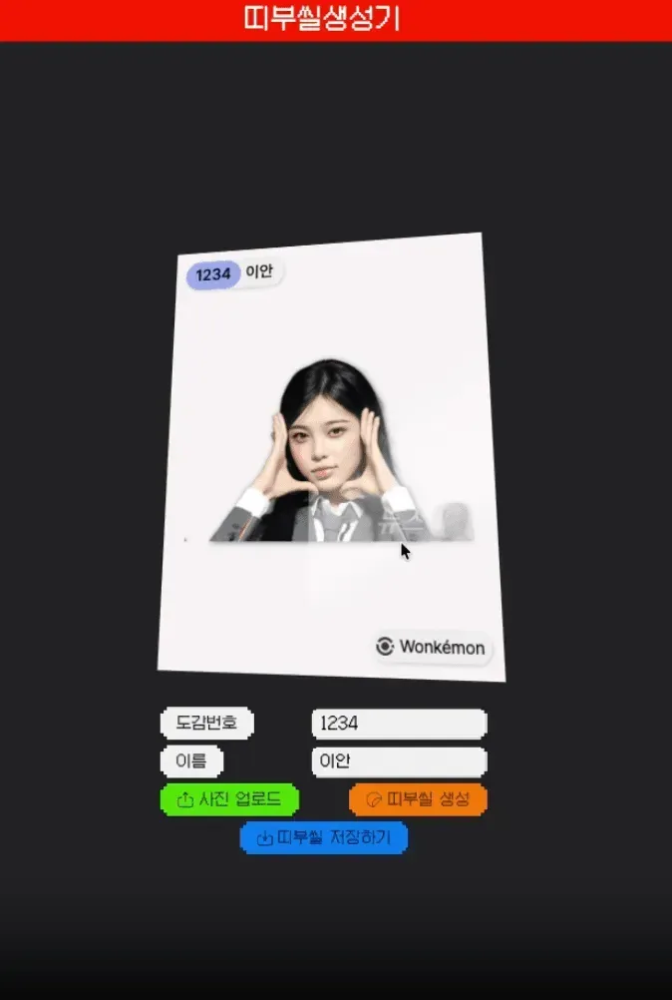

<div align="center">

# ⚡ 띠부씰 메이커 (Pokemon Sticker Maker)

**내 사진으로 나만의 포켓몬 띠부씰을 만드는 웹 토이 프로젝트**


[**만들어 보기 →**](https://jiwonsudo.github.io/Pokemon-Sticker-Maker)





</div>

## 기능

- **이미지 업로드** — 원하는 사진을 올리면 `@imgly/background-removal`로 브라우저에서 배경을 자동 제거
- **꾸미기** — 이름 · 번호 · 제작자를 입력해 띠부씰 디자인에 반영
- **홀로그램 효과** — 마우스 움직임에 반응하는 광택(Glow) 커버와 스티커 텍스처
- **저장** — `html2canvas` + `file-saver`로 완성된 띠부씰을 이미지로 다운로드

마우스 인터랙션과 TypeScript 타입 설계를 연습하기 위해 1인으로 만들었습니다.

## 실행

```bash
npm install
npm start
npm run deploy   # GitHub Pages 배포
```
